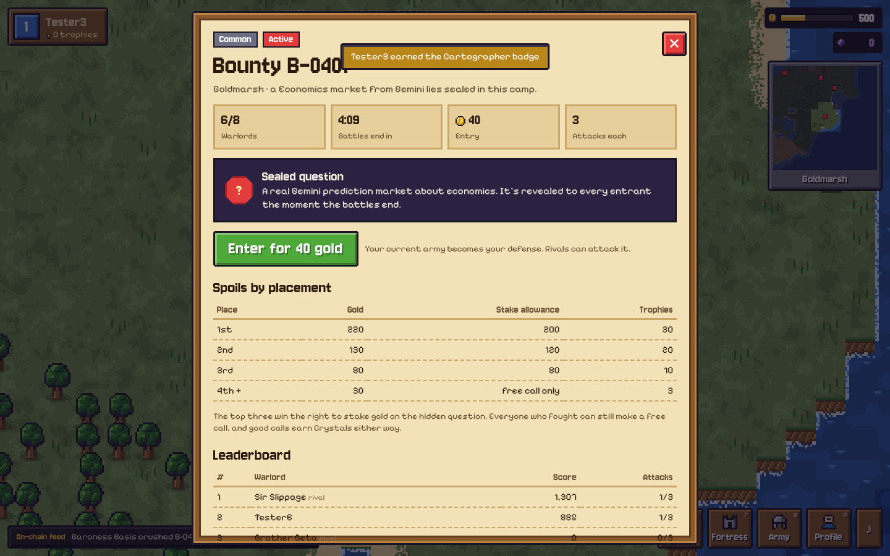
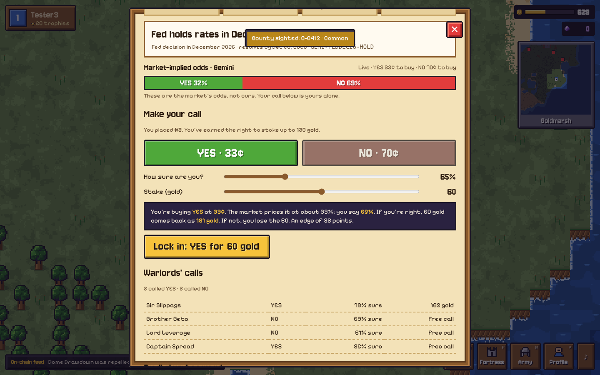

# Fortune Front

An 8-bit strategy game built on real prediction markets. Explore a huge world for **blind bounties**, out-fight rival warlords to win the right to bet, then call the **live Gemini market** that was sealed inside. Badges mint to your **Solana** wallet, and the game learns about every on-chain event through **QuickNode Streams**.


Built for UBC 2026 from our design doc. Its three technologies each have a distinct job: Solana for ownership and verifiable records, Gemini for market data, and QuickNode Streams for blockchain events. See [How Fortune Front uses Solana](#how-stakeclash-uses-solana) (with every program ID) and [How Fortune Front uses Gemini](#how-stakeclash-uses-gemini-prediction-markets).

---

## The loop

1. **Explore.** Your own fortress sits on the map near Kingsmarket. Press **H** (or **Home**) to recall there any time you haven't fought in the last 30 seconds. The world is 384 × 384 tiles across seven realms, and each realm is one kind of Gemini market: Crownlands (politics), Frostpeaks (weather), Ironvein Badlands (crypto), Goldmarsh (economics), Sunscar Dunes (commodities), Arena Plains (sports) and Whisperwood (culture).
2. **Search the map** (M). **Every realm always has at least one bounty open for battle**: when one ends, the next in line opens early or a fresh one spawns. Bounties you haven't found show only as rumour circles, so walk into one to find the camp. You can filter by category and status, set a course, or fast-travel between waystones you've touched.
3. **Enter blind.** You see the tier, rewards, entry fee, rivals and time left, but never the question. All you know is its category, because of the realm it's in.
4. **Battle.** You get 3 asynchronous attacks against rival warlords' armies or the camp guardian. Battles are deterministic, so the replay you watch is exactly what scored. Score = damage dealt + a win bonus + survivors. Your own army defends you whenever rivals attack.
5. **The reveal.** When the battles end, every entrant sees the sealed Gemini question with its live odds. **The top 3 earn the right to stake gold** on it, and everyone else who fought gets a free call.
6. **Call it.** Pick YES or NO, say how sure you are, and set a stake. A coach line shows the price you're paying, your payout if right, and whether you have any edge over the market.
7. **Settlement.** When Gemini settles the market, a winning stake pays stake ÷ price. **Crystals** are paid for calibration (Brier score), so honest confidence earns the most.
8. **Grow your fortress.** Gold trains units and upgrades the Barracks, Training Grounds, Vault and Watchtowers. Only Crystals raise the **Keep**, and the Keep caps everything else, so long-term growth comes from forecasting well.
9. **Badges** for wins, titles and good calls mint as Solana Token-2022 collectibles. A badge counts as "On Solana" once QuickNode Streams delivers the transaction back to the game.

| | |
|---|---|
|  |  |
|  |  |

## Strategic combat (formations, Army → Formation)

Every battle is fought between two **3x3 formations**: front, mid and back rows across left, centre and right lanes. Each slot holds one stack of a unit type. Battles run in up to 16 rounds with integer-only math, so the same rules can later run inside a Solana program and give identical results. The browser replays the exact battle the server scored.

| Class | Units | What it does |
|---|---|---|
| Guardians | Shieldguards (heavy), Spearmen (light) | Absorb 35% / 15% of the damage aimed at troops behind them in their lane; engage enemy Raiders first |
| Raiders | Riders | Strike first and dive at Rangers, Artillery and Support; from a wing lane they slip past half the Guardians' protection |
| Rangers | Archers | Shoot from behind the line; +35% against Guardians and extra damage to exposed troops |
| Artillery | Siege | Hit the biggest enemy stack (+12% per 10 units in it) and splash the slots beside it |
| Support | Chaplains (new, Barracks 2) | Heal the most wounded slot nearby and cut damage to allies around them by 10% |

- **Position matters.** A mid/back slot whose lane has no living frontline is *exposed* and takes +25% damage.
- **Counters are bonuses, never sure wins:** Guardians → Raiders, Raiders → Rangers/Artillery/Support, Rangers → Guardians. Siege and Shieldguards also hit bosses 50% harder.
- **Orders** (one per battle, each with a cost):

| Order | Effect | Cost |
|---|---|---|
| Aggressive | +15% damage | +20% damage taken |
| Defensive | −20% damage taken | −10% damage |
| Focus Fire | everyone hits the weakest enemy slot, +5% damage | ignores class targeting |
| Hold Position | Guardians intercept +15%; Rangers shoot first | Guardians and Raiders skip round 1 |
| Flank | Raiders hunt exposed slots, +15% against them | everyone else −10% |

- **Presets:** Shield Wall, Flanking, Ranged and Assault. Each re-applies to your army as it changes; you can also place troops by hand. Your saved formation is also how you defend inside bounties. Attack prep (bounties and lairs) lets you pick a formation and order for that fight.
- **Combat report:** every battle ends with the 3–5 factors that decided it, for example "Your Shieldguards absorbed 1,240 damage aimed at the troops behind them". Green factors helped you; red ones helped the enemy.
- **Compatibility:**
  - Camp guardians, rival warlords and boss escorts all fight in formations.
  - Unit levels, Drills and relics still scale HP and damage.
  - Battles recorded before formations existed replay with the original engine.
- **Balance:** `npx tsx scripts/balance.ts` plays every army type and preset against each other at equal size. It checks that:
  - no army type dominates
  - every army type has a counter
  - the best formation depends on the army
  - formation and order choices swing results for the same army
  - every ability helps some army by at least 10 points, and no single ability pair is the best loadout for every army

## Gold and Might: two currencies, two jobs

- **Gold buys the numbers:** training troops, unit levels (+12% HP and damage per level, capped by the Training Grounds), buildings and bounty entry.
- **Might buys new tricks:** permanent **class abilities** that change how a battle plays. Might comes only from realized investment yield (and Colosseum winnings), so it's scarce on purpose.
- **Drills** (from bosses) are the small, capped stat bonus on top.

### Class abilities (Army, R)
Each ability is unlocked once with Might. Before each fight you **bring up to 2**; your saved loadout also defends you inside bounties. An ability only works if that class is on the field. Attack prep (bounties and lairs) lets you change the loadout for one fight.

| Class | Ability | Might | Effect |
|---|---|---|---|
| Guardians | Bulwark | 600 | Shieldguards absorb 50% (from 35%), Spearmen 25% (from 15%) for the troops behind them |
| Guardians | Taunt | 600 | In the first round, enemy Raiders must attack your Guardians instead of diving your backline |
| Raiders | Ambush | 900 | Raiders striking from a wing lane ignore Guardian protection entirely |
| Raiders | First Strike | 600 | Raiders get an extra attack at 35% strength in round 1 |
| Rangers | Volley | 600 | Each Ranger attack also hits the next target for 25% |
| Rangers | Pinning Shot | 600 | Rangers target Raiders first; a Raider stack they hit skips its next attack |
| Artillery | Bombardment | 900 | Splash hits every slot in the target's row at 50% |
| Artillery | Siege Breaker | 600 | Artillery aims at watchtowers and bosses first and hits them twice as hard |
| Support | Revive | 900 | Once per battle, your first wiped-out stack returns at 20% (and skips its next attack) while a Support stands |
| Support | Rally | 600 | +15% damage for your stacks in the Support's lane |

- All ten cost 7,200 Might (about 72 USDC of realized yield).
- The battle replay shows which abilities each side brought, and the combat report says what they did ("Your Chaplains revived your Archers").
- **NPCs bring them too:** epic bosses bring one ability that suits them and legendary bosses bring two. Rival warlords pick a loadout to match their favourite formation. Camp guardians bring none.
- **Mastery became abilities.** Mastery (+3% per rank, bought with Might) was removed. Every player's Mastery spend was refunded in Might once, when the server started.
- Numbers live in `shared/rules.js` (`ABILITIES`, `MAX_LOADOUT`). The effects use integer math in `shared/battle2.js`, so they can move on-chain unchanged.

## On-chain program, QuickNode indexer and the Economic Board

Everything that moves value or decides a result belongs to the Fortune Front Solana program (`programs/`; build and deploy steps in [programs/TEAMMATE.md](programs/TEAMMATE.md)).

- **Gold and Might are SPL tokens.** The program's config PDA is their mint authority and holds each player's custodial account, so buying something burns tokens without a wallet pop-up.
- **Stakes** for duels (and later bounties) sit in a program vault until they settle.
- **Battles are resolved on-chain** by a Rust port of battle engine 2 (`programs/battle`), seeded from SlotHashes. It mirrors `shared/battle2.js` step for step, so the game can replay exactly what the chain decided.
  - Unit levels come from the on-chain profile; abilities must be unlocked there.
- **Every action emits a versioned event:** registration, Gold settlement, Might minted or burned, unit upgrades, ability unlocks, loadouts and formations, stakes, rewards, yield conversion and battles.

**How the game uses it** (`server/chain/onchain.ts`):
- Each action is applied in the game at once and queued as a program instruction. The queue is persisted, ordered and retried until confirmed.
- Gold and Might use a shadow ledger: explicit actions (upgrades, unlocks, stakes, payouts) adjust it, and a settlement every 30 seconds mints or burns the rest, netting many small changes into one instruction.
- **Before the program is deployed** the bridge runs in **local mode**. Each action produces the exact event the program would emit, labelled local. The screens below work now, say plainly that their data isn't on-chain yet, and switch to on-chain data when the program goes live.
- **The chain decides every battle that involves a real player** (`server/chain/arbiter.ts`).
  - When you attack a bounty, challenge a boss or answer a duel, the game validates the fight, sends it to the program and waits about a second while a "Battle being decided on Solana…" overlay shows.
  - It reads the seed from the `BattleResolved` event and re-runs the same engine with it, so the replay is exactly what the chain decided. Losses, loot, score and payouts all come from that result.
  - Nothing is applied until then, and you can't start a second battle meanwhile.
  - If the network is slow the request returns "pending" and the client polls until the result lands.
  - The result card says who decided the battle and links the transaction.
  - Before deployment the server rolls the seed and the same code runs at once. `CHAIN_PROGRAM=simulate` acts like the chain (a short delay and a random seed), for testing the waiting flow.

**QuickNode is the primary way the game reads the chain** (`server/chain/indexer.ts`):
- **Streams:** the filter forwards the program's transaction logs. The webhook checks the HMAC, then decodes the Anchor events.
- **RPC backfill:** `getSignaturesForAddress(program)` and `getTransaction`, from a saved cursor, fill any gap (for example while the Stream was paused).
- **State:** `getTokenSupply` for both mints, plus a WebSocket `accountSubscribe` on the mints for live updates.
- **Correctness:**
  - events are de-duplicated by (signature, event index)
  - failed transactions are skipped
  - each event is provisional at *confirmed* and final at *finalized*
  - every derived number keeps its source signatures for explorer links

**Screens:**

| Screen | Where | Shows |
|---|---|---|
| Economic Board | Ledger (L) | Gold, Might and USDC: supply, minted, burned, spent on upgrades and abilities, escrowed, rewards, yield records, top holders, 24 h flow chart, verification links |
| Public profile | names on the board and in the Colosseum | battles, wins, losses and win rate by kind, Keep level, balances, realized yield, unit levels, abilities, recent battles and progression |
| Colosseum scouting | answering a challenge | the challenger's public stats |
| Warlord dossier | Intel (I) or Bag (B) | a rival's favourite orders and abilities, army mix, lane habits and how to beat them |

- **Public stats** never include formations, orders or loadouts.
- **Dossiers are relic-only:** you need a **Spyglass of the Watch**, an Information Relic that rare (20%), epic (35%) and legendary (50%) bosses drop.

## The SOL vault (T)

Bring your own crypto into the game. **Vault → Deposit** builds a transfer from your linked wallet to the game's vault (with a memo naming the deposit); Phantom, MetaMask or any Wallet Standard wallet asks you to approve it, or the in-game wallet signs it right there. The game checks the transaction on-chain before it counts, once per signature.

Your SOL stays SOL: nothing is sold or swapped. Every 10 seconds the vault is valued at **Gemini's live SOL/USD price**, and whenever its value reaches a **new high**, the growth above the old high becomes **Might** automatically (100 Might per $1). A dip and recovery never pays twice, deposits never count as growth, and withdrawals shrink the high-water mark in proportion. **Withdraw** sends SOL back to your verified wallet. Dev → Arena & odds has demo price buttons (SOL ±5%) for showing growth live.

## The yield economy (Treasury, T)

Realized investment yield becomes **Might**, which unlocks class abilities. Might comes only from real investment results. Everything runs on **devnet test USDC: no real money**.

1. **Deposit.** In the Treasury, create a deposit link and open it in Phantom. It's a Solana Pay request to send devnet USDC (free at faucet.circle.com) to the game's USDC account. The QuickNode Stream sees the transfer and the game credits it once. The link's reference key or your verified linked wallet matches the deposit to you.
2. **Invest.** Buy BTC, ETH, SOL, XRP, DOGE or HYPE at the live Gemini ask; sell at the bid. Positions are recorded at real prices with test money; there is no made-up APY.
3. **Realize.** Selling above your average cost is realized yield; selling below is a realized loss. The Overview keeps principal, cash, market value, unrealized and realized gains apart.
4. **Convert.** Only realized yield converts, at **1 USDC = 100 Might** (configurable in `shared/rules.js` `ECONOMY`). Principal never converts, and losses reduce what's eligible.
5. **Unlock.** Spend Might on class abilities in the Army screen (600 or 900 Might each). Gold still pays for troops and levels; bosses give the small Drills track (+15% max).
6. **Withdraw.** Cash goes back to your verified linked wallet as a USDC transfer. A failed transfer is refunded.

Money only changes on the server, in integer micro-USDC, and every money action carries a request id, so a retried request never doubles it.

| Setting | Default | Meaning |
|---|---|---|
| `USDC_MINT` | devnet: Circle's devnet USDC; local: a test mint `npm run setup-solana` creates | The token deposits and withdrawals use |
| `EXECUTOR` | `paper` | How trades fill. `paper` records fills at live Gemini prices |
| `STREAM_NETWORK_EVERY`, `INTEL_WATCH_MINTS` | 50, devnet USDC | Network sampling for crypto intel |

**Withdrawals on devnet** draw on the game's own USDC, so send the authority some test USDC (`npm run setup-solana` prints its USDC account and balance).

### Moving to real money later
The code is built so the switch is mostly configuration:
- point `NETWORK`, `SOLANA_RPC_URL` and `USDC_MINT` at mainnet (USDC `EPjFWdd5AufqSSqeM2qN1xzybapC8G4wEGGkZwyTDt1v`)
- implement the `SwapExecutor` in `server/funds.ts` so trades become real DEX swaps

The hard part isn't code. Holding players' money (custody), real-money PvP stakes and investment yield can fall under money-transmission, securities and gambling rules. A mainnet launch needs legal review and a security audit first. A non-custodial design, where funds stay in players' wallets, reduces that burden.

## Bosses, loot and intelligence

Away from the bounties, **21 bosses** guard fixed lairs across the seven realms. Find one by exploring (a "Boss sighted" toast; legendary bosses shake the ground), walk up to it and press **E**.

| Tier | How it looks | Who can beat it | Drill points | Relic | Intel |
|---|---|---|---|---|---|
| Common | Hero-sized, ring of stones | The starting army | 1 | – | 10% |
| Rare | 1.5× size, blue aura, bones and a torch | An early army (about Keep 2) | 2 | – | 25% |
| Epic | 2× size, purple aura, spiked palisade, braziers | Level-4 armies | 4 | 10% | 45% |
| Legendary | 3× size, scorched ground, flame aura, skull totems | Maxed armies only | 8 | 25% | 70% |

- **Battles** use the same deterministic simulator as bounties: your army against the boss's guards plus the boss itself as one huge champion unit. Siege and Tanks hit bosses hard; arrows barely scratch them. Units that fall are lost.
- **Fair play.** Rewards are rolled and paid on the server. You must stand at the lair, and every attempt (won or lost) sends the boss back to its den for a while (5 to 60 minutes by tier). Each challenge carries a request id, so a retried or duplicated request returns the stored result instead of fighting or paying twice.
- **Bosses give no gold.** Their reward is a **minor army upgrade**: drill points, assigned in the Army screen (R). Each point gives one unit type +0.5% HP and damage, up to 30 points (+15%) per unit. At most 12 points can be earned per day.
- **Drills are deliberately small** next to unit levels (Gold) and abilities (Might, from realized investment yield). Fighting bosses is always worth it, but it never replaces investing.
- **Relics** (epic and legendary bosses) are permanent: extra vault capacity, extra watchtowers when rivals attack you, or damage bonuses the battle simulator applies.
- **The Bag (B)** shows your drill pool and relics. Materials, training manuals and upgrade scrolls earned before this change still work, but bosses no longer drop them.
- **Badges:** Boss Slayer, Giant Killer (a legendary), Relic Hunter (3 relics) and Spymaster (10 reports) mint like the others.
- Every boss number and drop chance lives in `shared/rules.js` (`BOSS_TIERS`, `BOSSES`, `RELICS`).

### Intelligence reports (I)

Bosses sometimes carry an **intelligence report**: real data about **one specific market**. The bosses of Arena Plains carry sports intel, Ironvein crypto, Goldmarsh economics, and the other realms general intel (politics, weather, commodities, culture).

1. **Which market.** Your open call first, then a bounty you fought in, then an open Gemini market in that category. A market still sealed inside an unrevealed bounty is never used, so intel can't spoil a blind bounty.
2. **What it asks.** The market is read into a scenario using Gemini's own fields (the league in the ticker, the teams in `participants`, the contract's `strike`): an award race, a match, a points total, a spread, a player prop, a price strike, an economic threshold or a weather range.
3. **The data that answers it.** "Shai Gilgeous-Alexander wins MVP" gets his season stats against the other contenders, his recent games and both teams' records. "More than 231.5 points" gets both teams' scoring and how often their games went over 231.5. "BTC $61,200 or above" gets the distance to the strike and how often BTC has moved that far in that much time.

| Category | Live sources (no keys) |
|---|---|
| Sports | ESPN: athletes, game logs, team records, schedules, team news |
| Crypto | Gemini exchange price history; **QuickNode** for Solana activity |
| Economics | World Bank (annual), or FRED monthly series with a free `FRED_API_KEY` |
| Weather | Open-Meteo forecasts and recent observations |
| Headlines | GDELT |
| Odds | Gemini prediction markets |

Rarity sets the depth: a common report has one section, a legendary one has everything plus the market's own odds. Reports are added to your collection the moment the boss falls and fill in a few seconds later. Each is stamped **Live data** or **Sample data**. When a source can't be reached, that part is labelled sample data, never presented as real. `INTEL=off` uses sample data only.

**QuickNode** is used for blockchain data only. Besides the game's own transactions, the Stream filter now summarises one block in every 50 slots (transactions, failure rate, busiest programs, watched-token transfers). The server stores those samples deduplicated by slot, after the same HMAC check. Crypto reports combine them with throughput, epoch and fee data from the QuickNode RPC endpoint. On devnet without a Stream, `USE_LOCAL_STREAM=1` samples blocks the same way.

## The Colosseum (K)

1v1 duels for Might on a **live Gemini market**. Both warlords put up the same Might, send an army, and make a call (YES/NO and how sure they are) on the same market.

1. **Issue a challenge.** Pick an open market (each shows its live odds, last-hour move and a chart), make your call, choose a stake and an army. The stake is held in escrow.
2. **Your call is committed on Solana at once**, before anyone fights. The game posts a memo `stakeclash:v1:call:<duel>:<player>:<sha256>`, where the hash covers the duel, player, market, side, confidence, **the Gemini price at that moment**, the time and a random salt. Your rival sees only the hash.
3. **Answer a challenge.** Another warlord (or, after 25 seconds, a rival warlord bot with its own trading style: momentum or contrarian) answers with their army and their own committed call.
4. **Steel.** The armies fight at once in formations (each side's saved preset and order, with its ability loadout); the replay is the fight that scored. The winner takes the **steel half** of the pot. Arena fights are to first blood: no units are lost.
5. **Foresight.** The other half waits for Gemini to settle the market, then goes to the **better-calibrated call** (lower Brier score). Equal calls split it. 5% of each pot is burned so Might doesn't inflate.
6. **Sealed result.** On settlement the full result (both calls with their salts, the battle seed and winner, the outcome and payouts) is hashed and posted as `stakeclash:v1:duel:<duel>:<sha256>`.

After the fight, both calls are revealed in **My duels → How to verify**, so anyone can recompute each hash and compare it with the memo on Solana. That proves the call, and the odds it was made at, were fixed before the fight. QuickNode Streams delivers each memo back to the game, which marks the receipt **On Solana ✓** only when the hash on-chain matches. The first steel win earns the **Gladiator** badge (Token-2022, like the others).

## Odds board and the town crier (O)

Gemini's prediction-markets REST API returns current prices but no odds history, so **the server records it**: every open market's mid price is sampled (every 10 s with mock Gemini, 60 s live; `ODDS_SAMPLE_SECONDS`) and kept for 24 hours in `.data/<network>/odds.json`.

- **Odds board (O):** the biggest movers over 15 min / 1 h / 6 h / 24 h with sparklines, and a full pixel chart per market with high, low, change and a plain-English line ("YES trades at 62¢, so the market puts this at about a 62% chance").
- **Charts in context:** a revealed bounty question shows how its odds moved over the last 6 hours; every intelligence report about a market shows its last 24 hours.
- **The town crier:** Barnaby the Crier stands in the top-left corner of the screen. When a market moves sharply (8¢ in 10 min with mock Gemini, 4¢ in an hour live) he rings his bell and shouts the headline in a speech bubble; click him to talk, page through his latest news, and jump to that market's chart or a duel on it. Headlines also go up in the realm feed ("odds on “BTC above $100,000” jumped from 41¢ to 55¢"); click the ticker to open that market's chart.
- **Hot bounties:** a sharp move can stir up the market's realm: a featured bounty around that market appears there, its question sealed like any other.
- **Duel from any chart:** "Duel on this market in the Colosseum" opens a challenge with that market picked.

## How Fortune Front uses Solana

Everything on-chain uses existing Solana programs; Fortune Front deploys no program of its own.

| Program | ID | What Fortune Front does with it |
|---|---|---|
| SPL Token-2022 | `TokenzQdBNbLqP5VEhdkAS6EPFLC1PHnBqCXEpPxuEb` | Each badge (First Blood, Boss Slayer, Gladiator…) is its own mint with the **MetadataPointer** and **TokenMetadata** extensions: name, symbol and image live on the mint. One badge is minted to a player's wallet when earned. |
| SPL Token | `TokenkegQfeZyiNwAJbNbGKPFXCWuBvf9Ss623VQ5DA` | **Devnet USDC** (`4zMMC9srt5Ri5X14GAgXhaHii3GnPAEERYPJgZJDncDU`, Circle's devnet mint) for Treasury deposits and withdrawals |
| Associated Token Account | `ATokenGPvbdGVxr1b2hvZbsiqW5xWH25efTNsLJA8knL` | Creates each player's badge and USDC accounts (idempotent) |
| Memo (v3) | `MemoSq4gqABAXKb96qnH8TysNcWxMyWCqXgDLGmfcHr` | Verifiable records: badge mints, sealed bounty standings, **Colosseum odds receipts** (committed calls) and sealed duel results, withdrawals |
| System | `11111111111111111111111111111111` | Accounts for mints; fees are paid by the game authority |

- **Solana Pay:** Treasury deposits are Solana Pay transfer links with a reference key, so Phantom can pay devnet USDC straight into the game.
- **Wallets:** an in-game Ed25519 wallet (no install), Phantom, MetaMask's Solana account, any Wallet Standard wallet (Solflare, Backpack…), or a pasted address. Linking is a signed message, checked on the server.
- **QuickNode Streams** watches the chain and posts the game's transactions to `/webhooks/quicknode` (HMAC-verified, de-duplicated by signature). That's how badges become "On Solana", standings and duel results become verified, Colosseum receipts get their ✓, and deposits are credited exactly once.
- `npm run setup-solana` prints the authority address and every badge mint for your network; `/api/config` and `/api/health` list them too.

## How Fortune Front uses Gemini prediction markets

| Endpoint | Used for |
|---|---|
| `GET /v1/prediction-markets/events?status=active` | Every open market: bounties spawn from them by category, the Colosseum lists them, and the server samples their prices for odds history, movers and the town crier |
| `GET /v1/prediction-markets/events/{ticker}` | Looking up one market's contract and live bid/ask (calls in bounties and duels are priced from it) |
| `GET /v1/prediction-markets/events/recently-settled` | Settling bounty predictions and Colosseum duels with Gemini's own resolution |

Markets are always keyed by Gemini's `instrumentSymbol`. YES is bought at the ask, NO at 1 − bid; payouts are stake ÷ price, and calibration is scored with the Brier score. `GEMINI_MODE=mock` runs a local server with the same endpoints (plus settle and jolt buttons for demos).

## Wallets

Badges need a Solana wallet to mint to. **Profile → Solana wallet** offers four ways, so nobody has to install anything:

| Option | How it works |
|---|---|
| **In-game wallet** (no install) | A keypair made in your browser with built-in Ed25519 crypto and kept there. **Back up key** shows it in the format Phantom and Solflare import ("Import private key"). **I have a key** restores it in another browser. |
| **Phantom** | Connects the Phantom extension or app. |
| **MetaMask** | Connects MetaMask's built-in Solana account (found through the Wallet Standard). |
| **Other Solana wallets** | Solflare, Backpack and any wallet that supports the Solana Wallet Standard are detected automatically. |
| **Just an address** | Paste any Solana address (hardware, mobile, exchange). It's receive-only and marked unverified. |

The first three prove the wallet is yours by signing a one-time message. That's no transaction and no fee; the server checks the ed25519 signature. You can **Switch wallet** at any time. Badges you've earned but not yet minted go to whichever wallet you link next.

---

## Quick start

Needs Node 20 or newer. Nothing else: Solana runs locally inside the game (see below).

```bash
npm install
npm run dev
```

Open **http://localhost:4000**, choose **New warlord**, and pick a name and a password (8+ characters). Next time, use **Sign in**. **Log out** is in Profile; closing the tab or browser also signs you out (a refresh doesn't), and every sign-in starts at your fortress gate.

- **Move:** WASD / arrows, or click to walk (it finds the way around obstacles). Hold **Shift** to sprint. **E** interacts, scroll zooms, drag looks around.
- **Terrain:** only what you can see blocks you (trees, rocks, mountain peaks, water). Mountain ranges are walkable rock with peaks scattered on them, and winding passes through every range. Dense forests have trails. A walk anywhere is on average only about 15% longer than a straight line.
- **Shortcuts:** **H** home, **M** map, **F** fortress, **R** army, **T** treasury, **B** bag, **I** intel, **P** profile. Walk up to your fortress and press **E** to manage it.
- **Dev tools** (the **Dev** button in the dock, or the `` ` `` key) cover everything a demo needs:
  - **Warlord:** set gold, Crystals and trophies, step any building or unit level, add troops, grant badges, or **Max everything** in one click. **Reset** puts you back to a new warlord.
  - **World:** reveal the whole map and attune every waystone, teleport to any town, your fortress or exact coordinates, and clear the combat cooldown.
  - **Bosses:** add test USDC or Might, teleport to any lair, reset boss cooldowns, add drill points and reset the daily limit, fill the Bag, grant relics, and choose the rarity of the next intel drop.
  - **Bounties:** spawn one in any realm (choose tier and featured) and jump to it. See every live bounty with its hidden question, and start, end or settle any of them (settling needs mock Gemini).
  - Inside a bounty sheet the same start, end and settle buttons appear.
  - The panel is on by default. Set `DEV_TOOLS=off` in `.env` before sharing the game publicly.
- **Progress** is saved in `.data/local`. `npm run dev -- --fresh` starts over.
- **Tests:** `npm test` runs 152 end-to-end checks on a separate stack, so it never touches your game.

## 3-minute demo

1. Create a warlord. You start at the gate of your own little fortress beside Kingsmarket castle.
2. Press **M**. The map is mostly unexplored parchment covered in rumour circles. Filter **Sports**, pick a bounty, and press **Waystone** or **Set course**.
3. Walk into the circle. The camp appears ("Bounty sighted") with a red crossed-swords banner. Press **E**.
4. Point out the sealed question, the rewards by placement (only the top 3 can stake) and the rival leaderboard. Press **Enter**.
5. **Attack** the guardian, show the counters hint, and watch the replay. The score lands on the leaderboard.
6. **Demo tools → End battles now.** The question is revealed with Gemini's live odds. Make a call at 70% with a stake and read the coach line aloud.
7. **Settle YES.** The payout, Crystals and Oracle badge arrive. Open **Profile → Trophy Room** and click **Create an in-game wallet**: one click, nothing to install. Watch the badges flip to **On Solana** as Stream deliveries arrive. Mention the sealed-standings hash at the bottom of the bounty.
8. **Odds board (O).** Show the biggest movers and open one market's chart. Dev → **Arena & odds → Jolt a market**: the town crier shouts about it and the chart jumps.
9. **Colosseum (K).** From that chart press **Duel on this market**. Make a call, stake some Might (Dev → +1,000 Might), issue the challenge, and point at "Posting to Solana…" turning into **On Solana ✓**. Dev → **A rival answers now**, watch the fight, then **Dev: settle YES** on the duel card and open **How to verify**.
10. **Home.** Press **H**. You can't recall straight after a battle ("still in combat"); wait 30 seconds, recall, then open your fortress, where Crystals raise the Keep and the courtyard visibly grows.

---

## How it maps to the design doc

| Doc | Where it is |
|---|---|
| World map: zoom, pan, markers, status, participants, rewards, featured | The overworld (`web/js/world-view.js`) plus the Map overlay (`web/js/map.js`): banners per status, gold glow for featured, filters and search |
| Blind bounty entry | `bountyFor()` in `server/bounties.ts` returns no question or market until the battles end, and only to entrants. Tested. |
| Bounty page: ID, status, participants, requirements, duration, leaderboard, rewards | The bounty sheet (`web/js/screens/bounty.js`) |
| Battle system: asynchronous simulation | `shared/battle.js`, the same deterministic code on server and client |
| Results: placement, history, stats, progression, achievements | Rankings and payouts in `finalize()`, Profile → History, badges |
| Gemini: exact market ID, YES/NO price, implied probability, status, resolution, previous predictions | Bounties store the Gemini `instrumentSymbol`, never a title match. The reveal shows the live bid/ask, implied odds, resolution date and other warlords' calls, then settles from Gemini. |
| Solana: wallet, collectibles, verifiable records | Phantom sign-in-with-message, Token-2022 badges with on-chain metadata, and memo-sealed standings hashes |
| QuickNode: detect events, validate, dedupe by signature, update records, reconcile | `streams/quicknode-solana-filter.template.js` → `/webhooks/quicknode` (HMAC) → `server/chain/stream.ts` |
| Fortress: Keep, Barracks, Training Grounds, Storage, Defenses, Trophy Room | Your fortress stands on the world map (recall with **H**). `web/js/screens/fortress.js`; Watchtowers really do defend you in battle. |
| Player profile: username, wallet, level, histories, achievements | Password accounts, log out, wallet link, record, history, Trophy Room, rankings |
| Army: Infantry, Archers, Tanks, Cavalry, Siege | Unlocks, levels, capacity, counters (`shared/rules.js`) |
| Analytics: odds over time, movers | `server/odds.ts` records Gemini prices; the odds board, bounty and intel charts (`web/js/odds-chart.js`, `web/js/screens/odds.js`) |
| PvP with market calls, verifiable on-chain | The Colosseum (`server/colosseum.ts`, `web/js/screens/colosseum.js`): commit-reveal odds receipts in Solana memos, sealed results |
| Off-chain vs on-chain split (doc 5.3) | Movement, battles and economy are off-chain. Badges and sealed results are on-chain. |

## Architecture

```
 Browser (web/)                                 Gemini prediction markets
  canvas overworld, map, battle replay           (mock server locally, api.gemini.com live)
        │ REST                                          │ markets, bid/ask, settlement
        ▼                                               ▼
 Game server (server/) ── bounty director: spawns bounties from markets into matching realms,
        │                 runs entries, battles, rival warlords, rankings, reveal, settlement
        │ Solana txs (fee payer = game authority)
        ▼
 Solana: Token-2022 badge mints · mint-to-wallet + memo · memo-sealed standings
        │
        ▼
 QuickNode Stream (Solana · Block dataset) ── filter keeps only the game's transactions
        │ signed webhook
        ▼
 /webhooks/quicknode → verify HMAC → dedupe by signature → badge status, holdings, sealed results
```

**Locally, nothing to install.** `localchain/rpc.ts` serves Solana JSON-RPC from **LiteSVM**, an in-process Solana runtime with the real SPL Token-2022, Associated Token and Memo programs. The game sends the same signed transactions it would on devnet. `localchain/stream-relay.ts` plays QuickNode's part: it reads each new block, runs the **same filter**, and posts it signed exactly like a QuickNode webhook.

---

## Run on Solana devnet with QuickNode Streams

### 1. RPC endpoint
Create a **Solana Devnet** endpoint in QuickNode, then in `.env` (copy `.env.example` first):
```
NETWORK=devnet
SOLANA_RPC_URL=https://<your-endpoint>.solana-devnet.quiknode.pro/<token>/
```

### 2. A public URL for the game
Wallets fetch badge images from your server, so give it a public address before creating the mints:
```bash
cloudflared tunnel --url http://localhost:4000     # or: ngrok http 4000
```
Put the `https://…` URL in `.env` as `PUBLIC_URL=`.

### 3. Authority and badge mints
```bash
npm run setup-solana
```
This creates the game authority in `.data/devnet/authority.json` and prints its address. If the airdrop is rate-limited, fund that address with ~1 SOL at [faucet.solana.com](https://faucet.solana.com) and run it again. It then creates 7 Token-2022 badge mints with on-chain metadata. It's safe to re-run, because it only creates what's missing.

### 4. The Stream
```bash
npm run print-filter       # writes streams/quicknode-solana-filter.devnet.js
```
In QuickNode, go to **Streams → Create Stream**:

| Setting | Value |
|---|---|
| Chain / network | Solana · Devnet |
| Dataset | **Block** |
| Start | latest block |
| Filter | paste `streams/quicknode-solana-filter.devnet.js` |
| Destination | Webhook → `https://<your-tunnel>/webhooks/quicknode` |
| Security token | copy into `QUICKNODE_WEBHOOK_SECRET` in `.env` |

The filter keeps only successful transactions that involve the game authority or a badge mint. It returns their game memos and badge balance changes, so transfers between wallets are tracked too, and returns nothing for every other block. Free-trial Solana Streams follow the chain tip only, so start the Stream before you play.

### 5. Play
```bash
npm run dev
```
Switch Phantom to Devnet (Settings → Developer settings), then link it from Profile. `http://localhost:4000/api/health` shows `streamDeliveries` climbing as the Stream delivers. While the Stream isn't ready, `USE_LOCAL_STREAM=1` polls devnet with the same filter instead.

## Live Gemini markets
`GEMINI_MODE=live` reads Gemini's public prediction-market endpoints (no key needed). Bounties then spawn from real markets and settle when Gemini settles them. For a live demo, `mock` lets you settle on cue.

---

## Scripts

| Command | Does |
|---|---|
| `npm run dev` | Runs everything for the current `NETWORK` (`-- --fresh` wipes local progress) |
| `npm test` | 152 end-to-end checks on an isolated stack |
| `npx tsx scripts/balance.ts` | Combat balance check (army types, presets, orders) |
| `npm run setup-solana` | Creates the authority and funds it if possible, then creates the badge mints |
| `npm run print-filter` | Writes the QuickNode filter with your addresses filled in |
| `npm run world-preview` | Renders the generated world to `docs/world-map.png` |
| `npm run typecheck` | TypeScript check |

## Layout

| Folder | What's in it |
|---|---|
| `shared/` | Formation battle engine (`battle2.js`), world generator, pixel-art sprites, battle simulator and game rules. These are the same files in the browser and on the server. |
| `server/` | API, bounty director, players and economy, boss lairs and loot (`bosses.ts`), JSON database, Solana (`chain/solana.ts`), Stream handling (`chain/stream.ts`) |
| `server/funds.ts`, `server/chain/usdc.ts` | The yield economy: ledger, trades, conversion into Might, USDC deposits and withdrawals |
| `server/odds.ts` | Odds history from Gemini prices, movers, the town crier, hot bounties |
| `server/colosseum.ts` | Colosseum duels: escrow, the fight, foresight settlement, odds receipts and sealed results |
| `server/intel/` | Intelligence reports: market selection, scenario parsing, the data providers and report assembly |
| `localchain/` | The local Solana RPC (LiteSVM) and the stream relay |
| `gemini/` | Gemini client and a mock server with the same endpoints |
| `streams/` | The QuickNode Streams filter |
| `web/` | The game client: plain JS and canvas, pixel fonts, chiptune sound effects made in the browser |

## Prototype limits

- **Untested paths.** The devnet and real-QuickNode setup uses the same standard Solana RPC calls and filter the tests run locally, but it hasn't yet been run against devnet itself. The same goes for live Gemini mode against `api.gemini.com`. On the first devnet run, watch `/api/health`.
- **Accounts and wallets.**
  - Accounts use a unique name and a password. Passwords are stored only as salted scrypt hashes, and 5 wrong tries lock a name for a minute.
  - There's no email recovery yet.
  - Accounts made before passwords existed set theirs on first sign-in.
  - In-game wallet keys live in the browser's local storage. That's convenient for testnet badges, but back up the key, and don't use it for real funds.
- **Gold.** Practice gold only: nothing is staked with real money.
- **Trust.** Battles and markets are resolved by the server. The chain holds the badges and a hash of every bounty's final standings, so the results can't be quietly changed afterwards.
