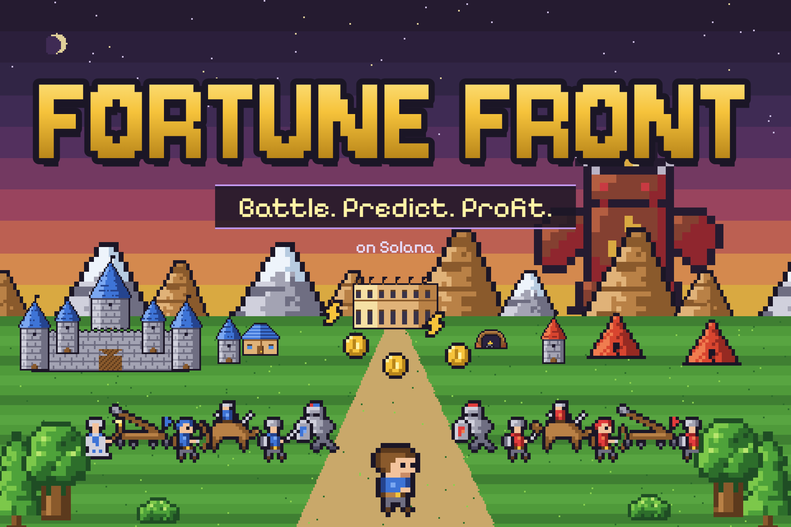
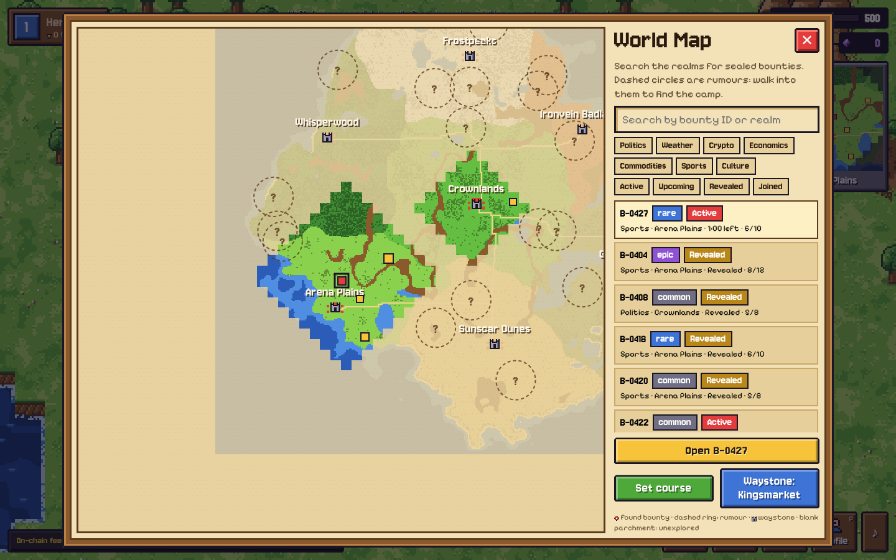
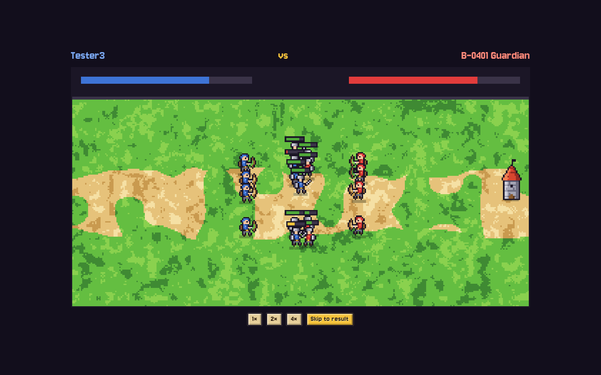
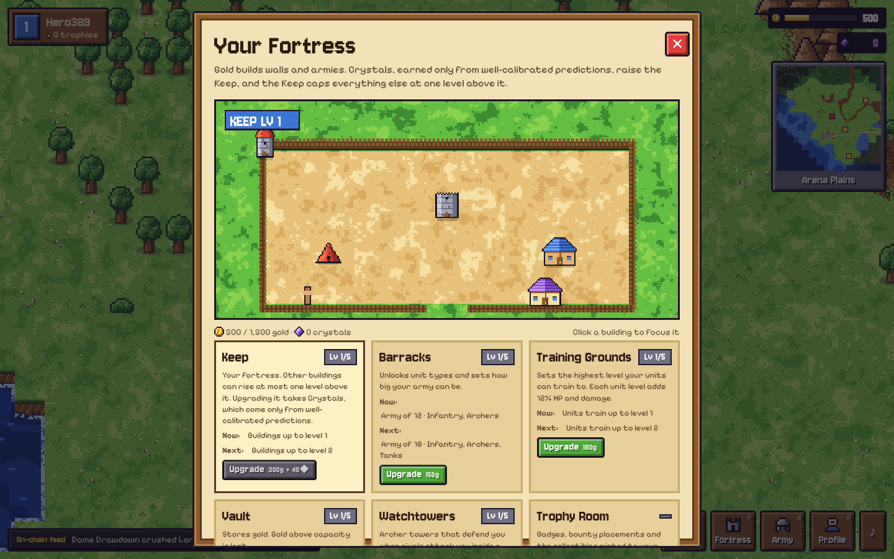

<div align="center">

# ⚔️ Fortune Front

**An 8-bit strategy game where you fight for the right to bet on real prediction markets, and the battles are decided on Solana.**

### [▶ Play now: ubchackathonproject-production.up.railway.app](https://ubchackathonproject-production.up.railway.app/)

**🟢 Live and deployed on Solana's public test network (devnet). Anyone can play it right now from the link above: no install, no wallet needed, no real money.**



`Solana devnet` · `Gemini prediction markets` · `QuickNode Streams` · Built for UBC 2026

</div>

---

## Contents

1. [What is Fortune Front?](#what-is-fortune-front)
2. [Play it](#play-it)
3. [Features](#features)
4. [How it's built](#how-its-built)
   - [Gemini](#gemini-the-markets-and-every-price)
   - [Solana and our smart contract](#solana-and-our-smart-contract)
   - [QuickNode](#quicknode-the-games-eyes-on-the-chain)
   - [Architecture](#architecture)
5. [Run it yourself](#run-it-yourself)
6. [Project layout](#project-layout)
7. [Status and limits](#status-and-limits)

---

## What is Fortune Front?

You explore a huge pixel-art world for **blind bounties**. Each one hides a real, live question from **Gemini's prediction exchange** ("Will BTC close above $61,200 today?", "Who wins the NBA MVP?"). You can't see the question until you've out-fought rival warlords for it. Winning earns the right to stake on it, and you're rewarded for being **well calibrated**, not just lucky.

Every battle that involves a real player is **decided by our own Solana smart contract**, so nobody, not even the game server, can pick the outcome. **QuickNode** is how the game sees the chain: it confirms every deposit, receipt and battle, and powers the live economy board.

| Technology | Its job in Fortune Front |
| --- | --- |
| **Gemini** | The questions players bet on, live odds, settlement, and every coin price in the game |
| **Solana** (devnet) | Our smart contract (battles, Gold and Might tokens, stakes, player profiles), badge collectibles, SOL and USDC deposits, verifiable memo receipts |
| **QuickNode** (RPC, Streams, WebSocket) | Sends every transaction, streams every on-chain event back, and feeds the indexer behind the Economic Board, public stats and spy dossiers |

| | |
| --- | --- |
|  |  |
|  |  |
|  |  |

---

## Play it

> **The game is deployed and public.** It's hosted at **https://ubchackathonproject-production.up.railway.app/** and runs on Solana's test network (devnet) with our smart contract live there. Anyone can open the link and play in the browser, on any computer, with nothing to install.

**[Open the live game](https://ubchackathonproject-production.up.railway.app/)**, choose **New warlord**, pick a name and a password (8+ characters), and you start at the gate of your fortress beside Kingsmarket. An in-game wallet is created for you, and everything uses **test money**: no real funds.

**Controls**

| Key | Does |
| --- | --- |
| WASD / arrows, or click | Walk (click finds the way around obstacles); hold **Shift** to sprint |
| **E** | Interact (bounty camps, boss lairs, your fortress) |
| **H** | Recall home (not within 30 s of a fight) |
| **M** · **F** · **R** · **T** | Map · Fortress · Army · Vault |
| **B** · **I** · **K** · **O** | Bag · Intel · Colosseum · Odds board |
| **L** · **P** | Ledger (Economic Board) · Profile |

**A 3-minute tour**

1. Press **M**, filter a category (say Sports), pick a bounty and **Set course**. Walk into the rumour circle and press **E** at the camp.
2. **Enter** the bounty. The question is sealed; you only know its category. **Attack** the guardian and watch the battle replay, decided on Solana.
3. When the battles end, the question is revealed with Gemini's live odds. Make a call (YES/NO + how sure you are) and a stake.
4. Press **O** for the biggest market movers. Barnaby the Town Crier (top left) shouts when a market jumps.
5. Press **K** for the Colosseum: challenge someone to a duel on a live market. Your call is committed on Solana before anyone fights.
6. Press **T** to deposit devnet SOL into the Vault and earn Might as SOL hits new highs. Spend Might on class abilities in the Army screen (**R**).
7. Press **L** for the Economic Board: Gold, Might and USDC flowing through the game, with links to every transaction.

---

## Features

### The game loop

1. **Explore** a 384 × 384-tile world with seven realms, each tied to one Gemini category: Crownlands (politics), Frostpeaks (weather), Ironvein Badlands (crypto), Goldmarsh (economics), Sunscar Dunes (commodities), Arena Plains (sports), Whisperwood (culture). Every realm always has at least one bounty open.
2. **Enter blind.** You see the tier, rewards, entry fee, rivals and time left, never the question.
3. **Battle.** Three asynchronous attacks against rival warlords' armies or the camp guardian. Your own army defends you when rivals attack.
4. **The reveal.** The sealed Gemini question appears with its live odds. The top 3 may stake Gold on it; everyone who fought gets a free call.
5. **Call it.** YES or NO, a confidence, and a stake. A coach line shows the price, the payout and whether you have an edge over the market.
6. **Settlement.** When Gemini settles, a winning stake pays stake ÷ price, and **Crystals** reward calibration (Brier score), so honest confidence earns the most.
7. **Grow your fortress.** Gold trains troops and builds; only Crystals raise the Keep, which caps every other building.

| Bounty tier | Entry | Players | Gold prizes (1st / 2nd / 3rd / rest) | Stake cap |
| --- | --- | --- | --- | --- |
| Common | 40 Gold | 8 | 220 / 130 / 80 / 30 | 200 / 120 / 80 / 0 |
| Rare | 90 Gold | 10 | 420 / 260 / 160 / 50 | 350 / 220 / 140 / 0 |
| Epic | 160 Gold | 12 | 700 / 420 / 260 / 80 | 600 / 360 / 240 / 0 |

Featured bounties pay 1.5×.

### Strategic combat

Every battle is fought between two **3 × 3 formations** (front, mid and back rows across three lanes) by a deterministic, integer-only engine. The replay you watch is exactly what scored, and the same engine runs inside the smart contract.

| Class | Units | Role |
| --- | --- | --- |
| Guardians | Shieldguards, Spearmen | Absorb 35% / 15% of the damage aimed at troops behind them; engage Raiders first |
| Raiders | Riders | Strike first and dive the backline; from a wing lane they slip past half the Guardians' protection |
| Rangers | Archers | Shoot from behind; +35% vs Guardians and extra damage to exposed troops |
| Artillery | Siege | Hit the biggest stack (+12% per 10 units) and splash its neighbours |
| Support | Chaplains | Heal the most wounded nearby slot; −10% damage to allies around them |

- **Position matters:** a mid or back slot with no living frontline in its lane is *exposed* and takes +25% damage.
- **Orders** (one per battle, each with a cost):
  - Aggressive: +15% damage, +20% taken
  - Defensive: −20% taken, −10% damage
  - Focus Fire: everyone hits the weakest slot
  - Hold Position: Guardians intercept more, but they and Raiders skip round 1
  - Flank: Raiders hunt exposed slots
- **Presets:** Shield Wall, Flanking, Ranged and Assault, or place troops by hand.
- **Combat report:** every battle ends with the 3–5 factors that decided it, such as "Your Shieldguards absorbed 1,240 damage aimed at the troops behind them".

**Class abilities**, bought once with Might; bring up to 2 into each battle:

| Class | Ability | Might | Effect |
| --- | --- | --- | --- |
| Guardians | Bulwark | 600 | Shieldguards absorb 50% (from 35%), Spearmen 25% (from 15%) |
| Guardians | Taunt | 600 | Round 1: enemy Raiders must attack your Guardians |
| Raiders | Ambush | 900 | Wing-lane Raiders ignore Guardian protection |
| Raiders | First Strike | 600 | An extra 35%-strength attack in round 1 |
| Rangers | Volley | 600 | Each attack also hits the next target for 25% |
| Rangers | Pinning Shot | 600 | Target Raiders first; a hit Raider stack skips its next attack |
| Artillery | Bombardment | 900 | Splash hits the whole row at 50% |
| Artillery | Siege Breaker | 600 | Aim at towers and bosses first, double damage to them |
| Support | Revive | 900 | Your first wiped stack returns at 20%, once per battle |
| Support | Rally | 600 | +15% damage in the Support's lane |

Epic bosses bring one ability and legendary bosses two; rival warlords bring a loadout that suits their formation. `scripts/balance.ts` checks that no army type, formation or loadout dominates.

### Barnaby the Town Crier and the odds board

Gemini's API gives current prices but no history, so the server samples every open market (every 60 s) and keeps 24 hours of odds.

- **Odds board (O):** the biggest movers over 15 min, 1 h, 6 h and 24 h, with pixel charts and plain-English odds ("YES trades at 62¢, so the market puts this at about a 62% chance").
- **Barnaby the Town Crier** stands in the top-left corner. When a market moves sharply (4¢ in an hour), he rings his bell and shouts the headline. Click him to page through his news and jump to the chart or a duel on it. His headlines also run in the realm feed.
- **Hot bounties:** a sharp move can spawn a featured bounty on that market in its realm.

### The Colosseum (K)

1v1 duels on a live Gemini market, where half the pot goes to the better fighter and half to the better forecaster.

1. **Challenge:** pick a market, make a call (YES/NO + confidence), stake Might and pick an army. The stake goes into escrow.
2. **Committed on Solana:** your call is posted immediately as a memo hash `stakeclash:v1:call:<duel>:<player>:<sha256>`, covering your side, confidence, **the Gemini price at that moment**, the time and a random salt. Your rival sees only the hash.
3. **Steel:** when someone answers (or a rival warlord does, after 25 s), the armies fight, decided on Solana. The winner takes the steel half. Arena fights are to first blood: no units are lost.
4. **Foresight:** the other half waits for Gemini to settle, then goes to the better-calibrated call (lower Brier score). 5% of each pot is burned.
5. **Verify:** after the fight both calls are revealed, so anyone can recompute each hash and check it against the memo on Solana. Receipts show **On Solana ✓** only when QuickNode delivers a matching hash.

Answering a challenge shows the challenger's public stats first.

### Bosses, loot, intelligence and spying

**22 bosses** guard fixed lairs across the realms. Walk up and press **E**.

| Tier | Looks | Beatable by | Drill points | Relic | Intel | Spyglass |
| --- | --- | --- | --- | --- | --- | --- |
| Common | Hero-sized | The starting army | 1 | – | 10% | – |
| Rare | 1.5×, blue aura | An early army | 2 | – | 25% | 20% |
| Epic | 2×, purple aura, 1 ability | Level-4 armies | 4 | 10% | 45% | 35% |
| Legendary | 3×, flame aura, 2 abilities | Maxed armies | 8 | 25% | 70% | 50% |

- **Drill points:** a small, capped stat boost per unit type (+0.5% each, up to +15%, at most 12 a day).
- **Relics:** permanent bonuses (extra watchtowers, vault capacity, damage).
- **Fair play:** you must stand at the lair; every attempt sends the boss away for 5–60 minutes; loot is rolled on the server.
- **Intelligence reports (I):** real data about **one specific market**, never one still sealed in an unrevealed bounty. The market's own fields (league, teams, strike) are parsed into a scenario, then answered with live data. Anything that couldn't be fetched is labelled *Sample data*.

  | Category | Live sources |
  | --- | --- |
  | Sports | ESPN |
  | Crypto | Gemini price history, QuickNode network data |
  | Economics | World Bank, FRED |
  | Weather | Open-Meteo |
  | Headlines | GDELT |
  | Odds | Gemini |

- **Warlord dossiers (spying):** a **Spyglass of the Watch** is the only way to see how a rival fights. It reveals their favourite orders and abilities, army mix, lane habits, win rates, last formation, and how to counter them. It's built from their indexed battle history.

### Rival warlords, the battle board and the leaderboard

- **Rival warlords** (computer-controlled players) enter bounties, attack real players, call around the market price, and answer Colosseum duels with their own trading style (momentum or contrarian).
- **The crowd:** after a reveal, everyone sees how the room called it (YES/NO counts and the latest calls).
- **The battle board:** every fight as it happens, with the winner, the loser and the Solana block that decided it.
- **The leaderboard** ranks warlords by trophies, and the realm feed streams joins, battles, boss kills, crier headlines and Solana confirmations.

### Currencies and the economy

| Currency | Earned from | Spent on | On-chain |
| --- | --- | --- | --- |
| **Gold** | Battles, bounty prizes, winning stakes | Troops, unit levels, buildings, bounty entry, stakes | SPL token via our contract |
| **Might** | SOL Vault growth, realized Treasury profit (100 Might per $1), Colosseum winnings | Class abilities, Colosseum stakes | SPL token via our contract |
| **Crystals** | Well-calibrated predictions | Raising the Keep | No |
| **SOL / USDC** | Your own wallet | Deposits into the Vault and Treasury | Real devnet transfers |

- **The Vault (T):** deposit SOL from your wallet. It's valued every 10 seconds at Gemini's live price, and growth above its high-water mark becomes Might automatically. A dip and recovery never pays twice. Withdraw any time.
- **The Treasury** (link inside the Vault): deposit devnet USDC with a Solana Pay link, trade BTC, ETH, SOL, XRP, DOGE and HYPE at Gemini's live bid and ask, and convert realized profit (never principal) into Might.
- **Idempotent money:** every money action carries a request id, and each deposit is credited once per transaction signature.

### Badges: 14 Solana collectibles

First Blood, Bounty Champion, Oracle, Called It, Cartographer, Warlord, Stronghold, Boss Slayer, Giant Killer, Relic Hunter, Spymaster, First Profit, Master-at-Arms and Gladiator.

Each badge is its own **Token-2022** mint with on-chain metadata. Earning one mints it to your wallet, and it shows **On Solana** once QuickNode Streams delivers the transaction back.

**Wallets** (Profile → Solana wallet):
- an in-game wallet (no install)
- Phantom, MetaMask, Solflare, Backpack, or any Wallet Standard wallet
- a pasted address (receive-only)

Linking is a signed message, so there's no fee.

---

## How it's built

### Gemini: the markets and every price

Two public Gemini APIs (no key needed) feed nine parts of the game:

| Feature | Gemini endpoint | What the game does with it |
| --- | --- | --- |
| Bounties | `GET /v1/prediction-markets/events?status=active`, `/events/{ticker}`, `/events/recently-settled` | Spawns bounties by category, seals the question, prices calls at the live bid/ask (YES at the ask, NO at 1 − bid), settles with Gemini's resolution |
| Odds history and movers | sampled `events` | 24 h of odds per market, movers, charts |
| Barnaby the Town Crier | sampled odds | Announces the biggest fresh mover, at most once per market per hour |
| Hot bounties | sampled odds | Spawns featured bounties on sharp moves |
| Colosseum | `events`, `/events/{ticker}`, `recently-settled` | Market list, the price locked into each committed call, foresight settlement |
| Intelligence reports | `events` + odds | Picks and parses the market, adds its odds |
| Rival warlords | bid/ask + odds history | Calls around the mid; momentum or contrarian duels |
| SOL Vault | `GET /v2/ticker/solusd` | Values every vault every 10 s |
| Treasury and crypto intel | `GET /v2/ticker/{coin}usd` | Trades at bid/ask; price history against a market's strike |

Markets are always keyed by Gemini's `instrumentSymbol`. `GEMINI_MODE=mock` runs a local server with the same endpoints, plus settle and jolt buttons for demos.

### Solana and our smart contract

**The Fortune Front program** (Rust, Anchor 0.31.1) is deployed on devnet at **`3bXC59d9UQihNDpY17QFbQTf9WavttgpdtfGfMRuGLAs`**. The code lives in [`programs/`](programs/README.md).

| Account (PDA) | Holds |
| --- | --- |
| `config` | Game authority, Gold and Might mints, battle counter (mint authority of both tokens) |
| `player` | Unit levels, drills, unlocked abilities and loadout, formation, wins and losses by battle kind, realized yield |
| `gold` / `might` | Each player's custodial token balances, so purchases burn without wallet pop-ups |
| `vault` / `stake` | Escrowed stakes for duels and bounties |

| Instruction | Does |
| --- | --- |
| `register_player` | Creates a profile and its token accounts |
| `settle_gold` | Mints or burns a player's net Gold, batched every 30 s |
| `convert_yield` · `mint_might` · `burn_might` | Might from realized yield, duel winnings, corrections |
| `upgrade_unit` · `assign_drills` · `unlock_ability` | Burns the price on-chain and records the upgrade |
| `set_loadout` · `set_formation` | Saves the battle setup |
| `escrow_stake` · `release_stake` | Locks a stake; pays winners and burns the fee |
| `resolve_battle` | Runs the battle engine on-chain, seeded from SlotHashes |

Every instruction emits a versioned event (`BattleResolved`, `GoldSettled`, `MightMinted`, `AbilityUnlocked`, `Escrowed`, …) that the indexer decodes.

**The chain decides every battle.** When you attack a bounty, challenge a boss or answer a duel:
1. The server validates the fight and sends `resolve_battle`.
2. The contract runs the battle with a seed nobody can pick (the latest SlotHashes entry XOR a counter) and emits the result.
3. The server reads the event back through QuickNode, re-runs the identical JavaScript engine with that seed, and applies exactly that result.

A "Battle being decided on Solana…" overlay shows meanwhile, and the result card links the transaction. If Solana is slow, the result arrives by polling. If it fails, nothing is applied and stakes are refunded.

**Other Solana programs we use:**

| Program | ID | Used for |
| --- | --- | --- |
| SPL Token-2022 | `TokenzQdBNbLqP5VEhdkAS6EPFLC1PHnBqCXEpPxuEb` | Badge collectibles with on-chain metadata |
| SPL Token | `TokenkegQfeZyiNwAJbNbGKPFXCWuBvf9Ss623VQ5DA` | Gold, Might, devnet USDC (`4zMMC9srt5Ri5X14GAgXhaHii3GnPAEERYPJgZJDncDU`) |
| Associated Token Account | `ATokenGPvbdGVxr1b2hvZbsiqW5xWH25efTNsLJA8knL` | Player token accounts |
| Memo v3 | `MemoSq4gqABAXKb96qnH8TysNcWxMyWCqXgDLGmfcHr` | Colosseum call receipts, sealed results and standings, badge records |
| System · Compute Budget | `11111111111111111111111111111111` · `ComputeBudget111111111111111111111111111111` | Accounts and transfers; compute for on-chain battles |

### QuickNode: the game's eyes on the chain

- **RPC:**
  - sends every transaction (contract instructions, badge mints, memos, withdrawals) through an ordered, retried queue that never sends the same thing twice
  - confirms and reads transactions, and backfills missed events with `getSignaturesForAddress` + `getTransaction`
  - reads token supply
- **Streams:** a filter (`streams/quicknode-solana-filter.template.js`) keeps only successful transactions that touch the game:
  - memos
  - badge transfers
  - USDC deposits matched by Solana Pay reference
  - the contract's event logs
  - a network sample every 50 slots for crypto intel

  It posts them to `/webhooks/quicknode`, which checks the HMAC signature and de-duplicates by transaction.
- **WebSocket:** live Gold and Might supply via `accountSubscribe`.
- **The indexer** (`server/chain/indexer.ts`) turns events into data:
  - de-duplicated by (signature, event index)
  - failed transactions skipped
  - provisional at *confirmed*, final at *finalized*
  - every number keeps its source signatures

  It powers the **Economic Board (L)** (Gold, Might and USDC supply, flows, holders and yield records), **public profiles**, **Colosseum scouting** and **Warlord dossiers**.

### Architecture

```
 Browser (web/)  ── canvas world, battle replays, Vault, Colosseum, Economic Board
        │ REST
        ▼
 Game server (server/, Node + TypeScript) ──────────────►  Gemini APIs
        │  bounties · bosses · Colosseum · Vault · odds · intel     markets, odds, prices, settlement
        │
        │  instruction queue (server/chain/onchain.ts)
        ▼
 QuickNode RPC ──► Solana devnet
                     ├─ Fortune Front program: battles, Gold/Might, stakes, profiles
                     ├─ Token-2022 badges · USDC · SOL vault · memo receipts
                     │
 QuickNode Streams ◄─┘  (filter keeps only the game's transactions)
        │ signed webhook
        ▼
 /webhooks/quicknode → HMAC check → de-duplicate → indexer → Economic Board, stats, dossiers
```

| Layer | Stack |
| --- | --- |
| Client | Plain JavaScript and HTML canvas; 154 pixel sprites drawn from a palette; chiptune audio generated live (no asset files) |
| Shared rules | `shared/rules.js` (every number), `shared/battle2.js` (the battle engine, also ported to Rust) |
| Server | Node 22, TypeScript, Express 5; a JSON database per network |
| Chain | `@solana/kit`, Anchor 0.31.1 (Rust) |
| Hosting | Docker on Railway |

---

## Run it yourself

<details>
<summary><b>Locally</b> (Node 20+)</summary>

```bash
npm install
cp .env.example .env
npm run dev
```

Open **http://localhost:4000**.
- **Mac and Linux:** the default `NETWORK=local` runs Solana in-process with **LiteSVM** (the real Token-2022, Associated Token and Memo programs), plus a relay that plays QuickNode's part with the same filter.
- **Windows:** LiteSVM has no Windows build, so set `NETWORK=devnet` (next section).

The **Dev** panel (`` ` `` key) sets up demos: grant Gold or Might, max a warlord, reveal the map, spawn and settle bounties, jolt a market so the crier shouts, make a rival answer your duel, or set a demo SOL price. Set `DEV_TOOLS=off` before sharing publicly.
</details>

<details>
<summary><b>On Solana devnet with QuickNode</b></summary>

1. **RPC:** create a Solana Devnet endpoint in QuickNode, then in `.env`:
   ```
   NETWORK=devnet
   SOLANA_RPC_URL=https://<your-endpoint>.solana-devnet.quiknode.pro/<token>/
   PUBLIC_URL=https://<your public address>
   ```
2. **Authority and badge mints:** `npm run setup-solana`. Fund the printed authority with about 1 SOL at [faucet.solana.com](https://faucet.solana.com) if the airdrop is rate-limited.
3. **The Stream:** run `npm run print-filter`, then create a QuickNode Stream:
   - **Chain:** Solana Devnet
   - **Dataset:** Block
   - **Filter:** paste `streams/quicknode-solana-filter.devnet.js`
   - **Destination:** webhook to `https://<your-host>/webhooks/quicknode`

   Put its security token in `QUICKNODE_WEBHOOK_SECRET`.
4. **Gemini:** `GEMINI_MODE=live` reads Gemini's real markets (no key); `mock` lets you settle on cue.
5. Run `npm run dev`. `/api/health` shows Stream deliveries climbing, and `/api/chain/program` shows whether battles are on-chain.
</details>

<details>
<summary><b>The smart contract</b></summary>

Built and deployed from macOS or Linux with Anchor 0.31.1. Step-by-step instructions are in [`programs/TEAMMATE.md`](programs/TEAMMATE.md):
1. Build: `anchor build`
2. Deploy: `solana program deploy`
3. Initialize: `npm run init-program`
4. Update the Streams filter.
5. Restart the server, which switches to on-chain mode by itself when it holds the contract's authority key. `npm run set-authority <address>` hands that key to another server.
</details>

<details>
<summary><b>Hosting</b></summary>

The included `Dockerfile` (Node 22) runs the game server on Railway, Render or Fly. The host's `PORT` is honoured, and `npm start` runs everything.
</details>

| Script | Does |
| --- | --- |
| `npm run dev` / `npm start` | Runs the game for the current `NETWORK` |
| `npm test` | End-to-end checks on an isolated stack (macOS/Linux) |
| `npx tsx scripts/balance.ts` | Combat balance check |
| `npm run setup-solana` | Game authority and badge mints |
| `npm run print-filter` | The QuickNode Streams filter with your addresses |
| `npm run program-keypair` · `init-program` · `set-authority` | Contract address, setup after deploy, authority handover |
| `npm run onchain-check` | Offline checks of contract encoding and the Streams filter |
| `npm run world-preview` | Renders the generated world to an image |
| `npm run typecheck` | TypeScript check |

---

## Project layout

| Folder | What's in it |
| --- | --- |
| `web/` | The game client: canvas world, screens (`web/js/screens/`), wallets, audio |
| `shared/` | Rules, battle engine, world generator and sprites, shared by browser and server |
| `server/` | API, bounties, bosses, Colosseum, Vault and Treasury, odds and the crier, intel (`server/intel/`) |
| `server/chain/` | Solana: transactions, the contract bridge and instruction queue, chain-decided battles, the Streams webhook and the indexer |
| `programs/` | The Anchor smart contract (`stakeclash/`) and its Rust battle engine (`battle/`) |
| `streams/` | The QuickNode Streams filter |
| `gemini/` | Gemini client and a mock server with the same endpoints |
| `localchain/` | Local Solana (LiteSVM) and the stream relay |
| `scripts/` | Dev runner, tests, balance, setup and deploy helpers |

---

## Status and limits

**Live and public:** the game is deployed at [ubchackathonproject-production.up.railway.app](https://ubchackathonproject-production.up.railway.app/) on Solana's test network (devnet), and anyone with the link can play. Our contract decides battles on-chain, and QuickNode Streams delivers the game's transactions back. Everything uses **test money**.

- **Real money:** the design is built to move to mainnet (real USDC stakes, a QuickNode mainnet endpoint). That needs a security audit, per-player custody in the contract, and legal review of real-money betting and holding funds first.
- **One authority:** one game server drives the contract at a time (the hosted site). Other copies run in a clearly labelled local mode.
- **Off-chain by design:** movement, exploration, Crystals, building levels, and fights between two computer rivals.
- **Accounts:** name + password (salted scrypt, lockout after 5 failed tries), no email recovery. The in-game wallet key lives in the browser: fine for devnet, not for real funds.

<div align="center">

**Built for UBC 2026 by Areeb Islam and renbb1016**

</div>
