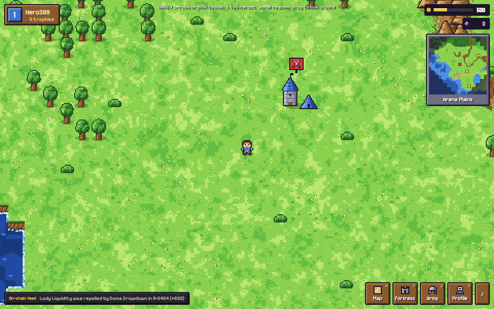

# StakeClash

An 8-bit strategy game built on real prediction markets. Explore a huge world for **blind bounties**, out-fight rival warlords to win the right to bet, then call the **live Gemini market** that was sealed inside. Badges mint to your **Solana** wallet, and the game learns about every on-chain event through **QuickNode Streams**.



Built for UBC 2026 from our design doc. Its three technologies each have a distinct job: Solana for ownership and verifiable records, Gemini for market data, and QuickNode Streams for blockchain events.

---

## The loop

1. **Explore.** Your own fortress sits on the map near Kingsmarket. Press **H** (or **Home**) to recall there any time you haven't fought in the last 30 seconds. The world is 384 × 384 tiles across seven realms, and each realm is one kind of Gemini market: Crownlands (politics), Frostpeaks (weather), Ironvein Badlands (crypto), Goldmarsh (economics), Sunscar Dunes (commodities), Arena Plains (sports) and Whisperwood (culture).
2. **Search the map** (M). **Every realm always has at least one bounty open for battle**: when one ends, the next in line opens early or a fresh one spawns. Bounties you haven't found show only as rumour circles, so walk into one to find the camp. You can filter by category and status, set a course, or fast-travel between waystones you've touched.
3. **Enter blind.** You see the tier, rewards, entry fee, rivals and time left, but never the question. All you know is its category, because of the realm it's in.
4. **Battle.** You get 3 asynchronous attacks against rival warlords' armies or the camp guardian. Battles are deterministic, so the replay you watch is exactly what scored. Score = damage dealt + a win bonus + survivors. Your own army defends you whenever rivals attack.
5. **The reveal.** When the battles end, every entrant sees the sealed Gemini question with its live odds. **The top 3 earn the right to stake gold** on it, and everyone else who fought gets a free call.
6. **Call it.** Pick YES or NO, say how sure you are, and set a stake. A coach line shows the price you're paying, your payout if right, and whether you have any edge over the market.
7. **Settlement.** When Gemini settles the market, a winning stake pays stake ÷ price. **Crystals** are paid for calibration (Brier score), so honest confidence earns the most.
8. **Grow your fortress.** Gold trains units and upgrades the Barracks, Training Grounds, Vault and Watchtowers. Only Crystals raise the **Keep**, and the Keep caps everything else, so long-term growth comes from forecasting well.
9. **Badges** for wins, titles and good calls mint as Solana Token-2022 collectibles. A badge counts as "On Solana" once QuickNode Streams delivers the transaction back to the game.

| | |
|---|---|
|  |  |
|  |  |

## Bosses, loot and intelligence

Away from the bounties, **21 bosses** guard fixed lairs across the seven realms. Find one by exploring (a "Boss sighted" toast; legendary bosses shake the ground), walk up to it and press **E**.

| Tier | How it looks | Who can beat it | Drill points | Relic | Intel |
|---|---|---|---|---|---|
| Common | Hero-sized, ring of stones | The starting army | 1 | – | 10% |
| Rare | 1.5× size, blue aura, bones and a torch | An early army (about Keep 2) | 2 | – | 25% |
| Epic | 2× size, purple aura, spiked palisade, braziers | Level-4 armies | 4 | 10% | 45% |
| Legendary | 3× size, scorched ground, flame aura, skull totems | Maxed armies only | 8 | 25% | 70% |

- **Battles** use the same deterministic simulator as bounties: your army against the boss's guards plus the boss itself as one huge champion unit. Siege and Tanks hit bosses hard; arrows barely scratch them. Units that fall are lost.
- **Fair play.** Rewards are rolled and paid on the server. You must stand at the lair, and every attempt (won or lost) sends the boss back to its den for a while (5 to 60 minutes by tier). Each challenge carries a request id, so a retried or duplicated request returns the stored result instead of fighting or paying twice.
- **Bosses give no gold.** Their reward is a **minor army upgrade**: drill points, assigned in the Army screen (R). Each point gives one unit type +0.5% HP and damage, up to 30 points (+15%) per unit. At most 12 points can be earned per day.
- **Drills are deliberately capped below Mastery,** the major upgrade track bought with the currency realized investment yield converts into (+3% per rank, up to +60%). Fighting bosses is always worth it, but it never replaces investing.
- **Relics** (epic and legendary bosses) are permanent: extra vault capacity, extra watchtowers when rivals attack you, or damage bonuses the battle simulator applies.
- **The Bag (B)** shows your drill pool and relics. Materials, training manuals and upgrade scrolls earned before this change still work, but bosses no longer drop them.
- **Badges:** Boss Slayer, Giant Killer (a legendary), Relic Hunter (3 relics) and Spymaster (10 reports) mint like the others.
- Every boss number and drop chance lives in `shared/rules.js` (`BOSS_TIERS`, `BOSSES`, `RELICS`).

### Intelligence reports (I)

Bosses sometimes carry an **intelligence report**: real data about **one specific market**. The bosses of Arena Plains carry sports intel, Ironvein crypto, Goldmarsh economics, and the other realms general intel (politics, weather, commodities, culture).

1. **Which market.** Your open call first, then a bounty you fought in, then an open Gemini market in that category. A market still sealed inside an unrevealed bounty is never used, so intel can't spoil a blind bounty.
2. **What it asks.** The market is read into a scenario using Gemini's own fields (the league in the ticker, the teams in `participants`, the contract's `strike`): an award race, a match, a points total, a spread, a player prop, a price strike, an economic threshold or a weather range.
3. **The data that answers it.** "Shai Gilgeous-Alexander wins MVP" gets his season stats against the other contenders, his recent games and both teams' records. "More than 231.5 points" gets both teams' scoring and how often their games went over 231.5. "BTC $61,200 or above" gets the distance to the strike and how often BTC has moved that far in that much time.

| Category | Live sources (no keys) |
|---|---|
| Sports | ESPN: athletes, game logs, team records, schedules, team news |
| Crypto | Gemini exchange price history; **QuickNode** for Solana activity |
| Economics | World Bank (annual), or FRED monthly series with a free `FRED_API_KEY` |
| Weather | Open-Meteo forecasts and recent observations |
| Headlines | GDELT |
| Odds | Gemini prediction markets |

Rarity sets the depth: a common report has one section, a legendary one has everything plus the market's own odds. Reports are added to your collection the moment the boss falls and fill in a few seconds later. Each is stamped **Live data** or **Sample data**. When a source can't be reached, that part is labelled sample data, never presented as real. `INTEL=off` uses sample data only.

**QuickNode** is used for blockchain data only. Besides the game's own transactions, the Stream filter now summarises one block in every 50 slots (transactions, failure rate, busiest programs, watched-token transfers). The server stores those samples deduplicated by slot, after the same HMAC check. Crypto reports combine them with throughput, epoch and fee data from the QuickNode RPC endpoint. On devnet without a Stream, `USE_LOCAL_STREAM=1` samples blocks the same way.

## Wallets

Badges need a Solana wallet to mint to. **Profile → Solana wallet** offers four ways, so nobody has to install anything:

| Option | How it works |
|---|---|
| **In-game wallet** (no install) | A keypair made in your browser with built-in Ed25519 crypto and kept there. **Back up key** shows it in the format Phantom and Solflare import ("Import private key"). **I have a key** restores it in another browser. |
| **Phantom** | Connects the Phantom extension or app. |
| **Other Solana wallets** | Solflare, Backpack and any wallet that supports the Solana Wallet Standard are detected automatically. |
| **Just an address** | Paste any Solana address (hardware, mobile, exchange). It's receive-only and marked unverified. |

The first three prove the wallet is yours by signing a one-time message. That's no transaction and no fee; the server checks the ed25519 signature. You can **Switch wallet** at any time. Badges you've earned but not yet minted go to whichever wallet you link next.

---

## Quick start

Needs Node 20 or newer. Nothing else: Solana runs locally inside the game (see below).

```bash
npm install
npm run dev
```

Open **http://localhost:4000**, choose **New warlord**, and pick a name and a password (8+ characters). Next time, use **Sign in**. **Log out** is in Profile; closing the tab or browser also signs you out (a refresh doesn't), and every sign-in starts at your fortress gate.

- **Move:** WASD / arrows, or click to walk (it finds the way around obstacles). Hold **Shift** to sprint. **E** interacts, scroll zooms, drag looks around.
- **Terrain:** only what you can see blocks you (trees, rocks, mountain peaks, water). Mountain ranges are walkable rock with peaks scattered on them, and winding passes through every range. Dense forests have trails. A walk anywhere is on average only about 15% longer than a straight line.
- **Shortcuts:** **H** home, **M** map, **F** fortress, **R** army, **B** bag, **I** intel, **P** profile. Walk up to your fortress and press **E** to manage it.
- **Dev tools** (the **Dev** button in the dock, or the `` ` `` key) cover everything a demo needs:
  - **Warlord:** set gold, Crystals and trophies, step any building or unit level, add troops, grant badges, or **Max everything** in one click. **Reset** puts you back to a new warlord.
  - **World:** reveal the whole map and attune every waystone, teleport to any town, your fortress or exact coordinates, and clear the combat cooldown.
  - **Bosses:** teleport to any lair, reset boss cooldowns, add drill points and reset the daily limit, fill the Bag, grant relics, and choose the rarity of the next intel drop.
  - **Bounties:** spawn one in any realm (choose tier and featured) and jump to it. See every live bounty with its hidden question, and start, end or settle any of them (settling needs mock Gemini).
  - Inside a bounty sheet the same start, end and settle buttons appear.
  - The panel is on by default. Set `DEV_TOOLS=off` in `.env` before sharing the game publicly.
- **Progress** is saved in `.data/local`. `npm run dev -- --fresh` starts over.
- **Tests:** `npm test` runs 99 end-to-end checks on a separate stack, so it never touches your game.

## 3-minute demo

1. Create a warlord. You start at the gate of your own little fortress beside Kingsmarket castle.
2. Press **M**. The map is mostly unexplored parchment covered in rumour circles. Filter **Sports**, pick a bounty, and press **Waystone** or **Set course**.
3. Walk into the circle. The camp appears ("Bounty sighted") with a red crossed-swords banner. Press **E**.
4. Point out the sealed question, the rewards by placement (only the top 3 can stake) and the rival leaderboard. Press **Enter**.
5. **Attack** the guardian, show the counters hint, and watch the replay. The score lands on the leaderboard.
6. **Demo tools → End battles now.** The question is revealed with Gemini's live odds. Make a call at 70% with a stake and read the coach line aloud.
7. **Settle YES.** The payout, Crystals and Oracle badge arrive. Open **Profile → Trophy Room** and click **Create an in-game wallet**: one click, nothing to install. Watch the badges flip to **On Solana** as Stream deliveries arrive. Mention the sealed-standings hash at the bottom of the bounty.
8. **Home.** Press **H**. You can't recall straight after a battle ("still in combat"); wait 30 seconds, recall, then open your fortress, where Crystals raise the Keep and the courtyard visibly grows.

---

## How it maps to the design doc

| Doc | Where it is |
|---|---|
| World map: zoom, pan, markers, status, participants, rewards, featured | The overworld (`web/js/world-view.js`) plus the Map overlay (`web/js/map.js`): banners per status, gold glow for featured, filters and search |
| Blind bounty entry | `bountyFor()` in `server/bounties.ts` returns no question or market until the battles end, and only to entrants. Tested. |
| Bounty page: ID, status, participants, requirements, duration, leaderboard, rewards | The bounty sheet (`web/js/screens/bounty.js`) |
| Battle system: asynchronous simulation | `shared/battle.js`, the same deterministic code on server and client |
| Results: placement, history, stats, progression, achievements | Rankings and payouts in `finalize()`, Profile → History, badges |
| Gemini: exact market ID, YES/NO price, implied probability, status, resolution, previous predictions | Bounties store the Gemini `instrumentSymbol`, never a title match. The reveal shows the live bid/ask, implied odds, resolution date and other warlords' calls, then settles from Gemini. |
| Solana: wallet, collectibles, verifiable records | Phantom sign-in-with-message, Token-2022 badges with on-chain metadata, and memo-sealed standings hashes |
| QuickNode: detect events, validate, dedupe by signature, update records, reconcile | `streams/quicknode-solana-filter.template.js` → `/webhooks/quicknode` (HMAC) → `server/chain/stream.ts` |
| Fortress: Keep, Barracks, Training Grounds, Storage, Defenses, Trophy Room | Your fortress stands on the world map (recall with **H**). `web/js/screens/fortress.js`; Watchtowers really do defend you in battle. |
| Player profile: username, wallet, level, histories, achievements | Password accounts, log out, wallet link, record, history, Trophy Room, rankings |
| Army: Infantry, Archers, Tanks, Cavalry, Siege | Unlocks, levels, capacity, counters (`shared/rules.js`) |
| Off-chain vs on-chain split (doc 5.3) | Movement, battles and economy are off-chain. Badges and sealed results are on-chain. |

## Architecture

```
 Browser (web/)                                 Gemini prediction markets
  canvas overworld, map, battle replay           (mock server locally, api.gemini.com live)
        │ REST                                          │ markets, bid/ask, settlement
        ▼                                               ▼
 Game server (server/) ── bounty director: spawns bounties from markets into matching realms,
        │                 runs entries, battles, rival warlords, rankings, reveal, settlement
        │ Solana txs (fee payer = game authority)
        ▼
 Solana: Token-2022 badge mints · mint-to-wallet + memo · memo-sealed standings
        │
        ▼
 QuickNode Stream (Solana · Block dataset) ── filter keeps only the game's transactions
        │ signed webhook
        ▼
 /webhooks/quicknode → verify HMAC → dedupe by signature → badge status, holdings, sealed results
```

**Locally, nothing to install.** `localchain/rpc.ts` serves Solana JSON-RPC from **LiteSVM**, an in-process Solana runtime with the real SPL Token-2022, Associated Token and Memo programs. The game sends the same signed transactions it would on devnet. `localchain/stream-relay.ts` plays QuickNode's part: it reads each new block, runs the **same filter**, and posts it signed exactly like a QuickNode webhook.

---

## Run on Solana devnet with QuickNode Streams

### 1. RPC endpoint
Create a **Solana Devnet** endpoint in QuickNode, then in `.env` (copy `.env.example` first):
```
NETWORK=devnet
SOLANA_RPC_URL=https://<your-endpoint>.solana-devnet.quiknode.pro/<token>/
```

### 2. A public URL for the game
Wallets fetch badge images from your server, so give it a public address before creating the mints:
```bash
cloudflared tunnel --url http://localhost:4000     # or: ngrok http 4000
```
Put the `https://…` URL in `.env` as `PUBLIC_URL=`.

### 3. Authority and badge mints
```bash
npm run setup-solana
```
This creates the game authority in `.data/devnet/authority.json` and prints its address. If the airdrop is rate-limited, fund that address with ~1 SOL at [faucet.solana.com](https://faucet.solana.com) and run it again. It then creates 7 Token-2022 badge mints with on-chain metadata. It's safe to re-run, because it only creates what's missing.

### 4. The Stream
```bash
npm run print-filter       # writes streams/quicknode-solana-filter.devnet.js
```
In QuickNode, go to **Streams → Create Stream**:

| Setting | Value |
|---|---|
| Chain / network | Solana · Devnet |
| Dataset | **Block** |
| Start | latest block |
| Filter | paste `streams/quicknode-solana-filter.devnet.js` |
| Destination | Webhook → `https://<your-tunnel>/webhooks/quicknode` |
| Security token | copy into `QUICKNODE_WEBHOOK_SECRET` in `.env` |

The filter keeps only successful transactions that involve the game authority or a badge mint. It returns their game memos and badge balance changes, so transfers between wallets are tracked too, and returns nothing for every other block. Free-trial Solana Streams follow the chain tip only, so start the Stream before you play.

### 5. Play
```bash
npm run dev
```
Switch Phantom to Devnet (Settings → Developer settings), then link it from Profile. `http://localhost:4000/api/health` shows `streamDeliveries` climbing as the Stream delivers. While the Stream isn't ready, `USE_LOCAL_STREAM=1` polls devnet with the same filter instead.

## Live Gemini markets
`GEMINI_MODE=live` reads Gemini's public prediction-market endpoints (no key needed). Bounties then spawn from real markets and settle when Gemini settles them. For a live demo, `mock` lets you settle on cue.

---

## Scripts

| Command | Does |
|---|---|
| `npm run dev` | Runs everything for the current `NETWORK` (`-- --fresh` wipes local progress) |
| `npm test` | 99 end-to-end checks on an isolated stack |
| `npm run setup-solana` | Creates the authority and funds it if possible, then creates the badge mints |
| `npm run print-filter` | Writes the QuickNode filter with your addresses filled in |
| `npm run world-preview` | Renders the generated world to `docs/world-map.png` |
| `npm run typecheck` | TypeScript check |

## Layout

| Folder | What's in it |
|---|---|
| `shared/` | World generator, pixel-art sprites, battle simulator and game rules. These are the same files in the browser and on the server. |
| `server/` | API, bounty director, players and economy, boss lairs and loot (`bosses.ts`), JSON database, Solana (`chain/solana.ts`), Stream handling (`chain/stream.ts`) |
| `server/intel/` | Intelligence reports: market selection, scenario parsing, the data providers and report assembly |
| `localchain/` | The local Solana RPC (LiteSVM) and the stream relay |
| `gemini/` | Gemini client and a mock server with the same endpoints |
| `streams/` | The QuickNode Streams filter |
| `web/` | The game client: plain JS and canvas, pixel fonts, chiptune sound effects made in the browser |

## Prototype limits

- **Untested paths.** The devnet and real-QuickNode setup uses the same standard Solana RPC calls and filter the tests run locally, but it hasn't yet been run against devnet itself. The same goes for live Gemini mode against `api.gemini.com`. On the first devnet run, watch `/api/health`.
- **Accounts and wallets.**
  - Accounts use a unique name and a password. Passwords are stored only as salted scrypt hashes, and 5 wrong tries lock a name for a minute.
  - There's no email recovery yet.
  - Accounts made before passwords existed set theirs on first sign-in.
  - In-game wallet keys live in the browser's local storage. That's convenient for testnet badges, but back up the key, and don't use it for real funds.
- **Gold.** Practice gold only: nothing is staked with real money.
- **Trust.** Battles and markets are resolved by the server. The chain holds the badges and a hash of every bounty's final standings, so the results can't be quietly changed afterwards.
